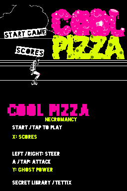
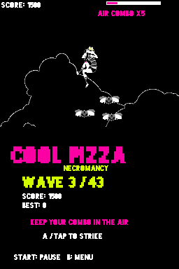

# Cool Pizza: Necromancy

An expanded Nintendo DS homebrew project built on **Cool Pizza**, the 2012 iOS
game by **Secret Library**. Necromancy is a place to develop new mechanics,
content and improvements around the original game's haunted-skateboard combat.

The starting game includes the version 1.4 artwork, music, enemies and wave
layouts. The [original reconstruction](https://github.com/nextcode4u/Cool-Pizza-NDS-)
continues separately with a focus on preserving the original experience.

## Screenshots

<p>
  
  
</p>

Captured in melonDS from the Necromancy baseline build.

## Video

[](https://youtu.be/6kZyAl-t4V4?t=110)

[Watch on YouTube from 1:50](https://youtu.be/6kZyAl-t4V4?t=110).

## Gameplay baseline

- Original 42-wave progression, with an extra tutorial on the first three runs.
- Bombing eyes, tracking sweepers, striking hands, flies and pyramids.
- Air combos and jump, shot, nuke and shield powers.
- Original soundtrack, sound effects, sprites and Blackout Midnight font.
- Touchscreen attacks, D-pad steering and local high scores.

## Play

Build `coolpizza-necromancy.nds` using the instructions below.

Open `coolpizza-necromancy.nds` in melonDS using standard DS mode and direct boot, or load
it through a DS homebrew flashcart. Music and effects are embedded in the ROM.

### melonDS Android

On **melonDS Android 2.0.2**, turn **JIT off** in the emulator settings before
launching. JIT-enabled startup can produce a black screen or crash; disabling
JIT resolves the reported startup issue. Use **DS mode** with **Show boot screen
off** (direct boot).

### Controls

| Control | Action |
| --- | --- |
| D-pad Left / Right | Steer |
| A / touchscreen tap | Attack in the air; activate an available power on the ground |
| Y / touchscreen power button | Activate a power |
| Start | Start, pause or resume |
| A / tap on menus | Start or retry |
| X on title/result screens | Scores |
| B | Return to title |
| Select | Mute / unmute |
| A / tap / Start / B during intro | Skip the current splash |

Landing resets the air combo. An unshielded hazard hit ends the run.
Best score and play count use `fat:/coolpizza-necromancy.stats` when writable FAT/DLDI
storage is available; otherwise they are kept for the current session.

## Build

The repository includes the prepared graphics, game data, music and effects.
Install devkitPro's Nintendo DS development tools, then build directly from a
fresh clone:

```sh
git clone https://github.com/nextcode4u/Cool-Pizza-NDS-Necromancy.git
cd Cool-Pizza-NDS-Necromancy
export DEVKITPRO=/opt/devkitpro
export DEVKITARM="$DEVKITPRO/devkitARM"
make -j2
```

See [the build guide](docs/build.md) for dependencies and optional asset
regeneration. An IPA, soundtrack download or emulator is not needed to build.

Output: `coolpizza-necromancy.nds`.

## Development

Necromancy welcomes new enemies, waves, powers, control options and presentation
improvements. See [project direction](docs/direction.md) for the development
scope and [contributing](CONTRIBUTING.md) for build and test commands.

## Documentation

- [Build guide](docs/build.md)
- [Gameplay baseline](docs/fidelity.md)
- [Asset formats and conversion](docs/recovery.md)
- [Runtime architecture](docs/reconstruction.md)
- [Testing](docs/emulator-testing.md)
- [Contributing](CONTRIBUTING.md)

## Credits

**Cool Pizza** was developed by **Secret Library**. **Matthew Marchini** was its
primary designer and artist; **Tettix** created the original soundtrack.
See [credits and references](CREDITS.md) for the original creators and the tools
used by this project.

This is an independent homebrew project. Cool Pizza's original artwork, music,
characters and branding belong to their respective creators.
